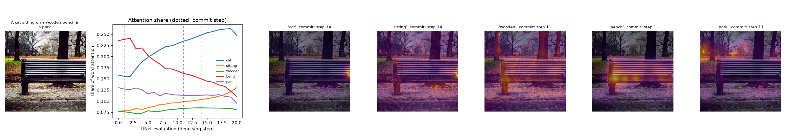

# Time Travel Inside a Diffusion Model

**Watching, rewinding and changing Stable Diffusion while it paints.** IE 7615 Deep Learning for AI (course project "From Words to Worlds"), Northeastern University, Fall 2026.



Stable Diffusion receives a whole sentence at once but paints it over 30 denoising steps. This repository records what the model does at every step: where each word's attention lands, and what the model's guess of the finished picture looks like. It also lets the painting be rewound to any step and continued with a changed sentence. On top of that it runs a series of experiments on when a picture is decided, when an edit can still take, and when a missing object is lost. Rewind, a viewer and a live tool, makes all of this visible.

## How the work fits together

| Stage | What it does | Code | Output |
|---|---|---|---|
| 1. Data | Downloads COCO val2017 and cleans its 25,014 captions to 25,004. Crops every image to 512 x 512 and freezes a 2,000-pair evaluation split | `src/w2w/data.py`, `src/w2w/prepare.py`, notebook 01 | `Results/m1_data/` |
| 2. Text to embedding | Encodes every caption with CLIP ViT-L/14 into the 77 x 768 states Stable Diffusion reads, and caches them. Checks retrieval and pixel-for-pixel parity with the stock pipeline | `src/w2w/encode.py`, `src/w2w/retrieval.py`, notebook 01 | `Results/m1_pipeline/` |
| 3. Generation | Stable Diffusion 1.5 from the cached states, and the timing benchmark | `src/w2w/generate.py`, `scripts/time_generation.py` | `Results/m1_pipeline/` |
| 4. Word timelines | Records cross-attention per word and per step without changing the image, then measures when each word's position settles (its commit step) | `src/w2w/attention.py`, notebook 02 | `Results/m1_word_timelines/` |
| 5. Editing experiments | Tests ways to change a picture partway through: pushing attention, swapping a word, adding a detail, dragging an object, rewinding with and without a mask, and finding when a missing object is lost | `src/w2w/steer.py`, `src/w2w/rewind.py`, `scripts/pilot_*.py` | `Results/m2_pilot_*/` |
| 6. Rewind | Our own sampling loop, which keeps every step so a painting can be resumed or branched. Comes as a viewer of prepared examples and as a live local tool | `src/w2w/rewind.py`, `src/w2w/live.py`, `scripts/make_rewind_demo.py`, `viewer/` | `Results/m2_rewind_demo/`, `Results/m2_rewind_live/` |

## Results so far

**Milestone 1, the pipeline:**

| Check | Result |
|---|---|
| Captions encoded and cached | 25,004 (5,000 COCO val2017 images) |
| Images from cached embeddings vs. Stable Diffusion's own output | identical (mean absolute pixel difference 0) |
| Attention recorder vs. stock pipeline | identical (mean absolute pixel difference 0) |
| CLIP caption-to-image retrieval over all 5,000 images | recall@1 35.5%, recall@5 59.9% (chance 0.02%) |
| Generation speed, 512x512, 30 steps, laptop RTX 5070 | 3.0 s per image (`Results/m1_pipeline/timing.json`) |

**Milestone 2, the experiments so far.** Each experiment's design and pass rules are fixed in its script's docstring before it runs.

| Experiment | Question | Finding |
|---|---|---|
| `m2_pilot_steering` | Does biasing one word's attention scores inside a box move its object? | No. The best strength moved 3 of 6 objects at step 0, under the pre-set bar of 4. |
| `m2_pilot_editing`, swap | Swap a word from step k: when does the new object stop appearing? | It appears in every usable case at k = 0, falling to 7% at k = 27. Each word's own commit step predicts the cut-off no better than one fixed step for all words. |
| `m2_pilot_editing`, detail | Add a detail from step k: how late does it still show? | Mostly only when started by step 3 to 6. Sunglasses and snow last until about step 12. A smiling cat never appears. |
| `m2_pilot_editing`, drag | Move an object by gradient guidance from step k | The object reaches the box (91% at k = 0), but the image degrades badly. Dropped. |
| `m2_rewind_demo`, `m2_rewind_live` | Can a painting be rewound and branched exactly, and live? | Our loop matches the stock pipeline exactly, and a branch with an unchanged sentence reproduces the original exactly. A live edit takes about 7 to 9 s on the laptop. |
| `m2_pilot_moments`, loss | When is a missing object lost? Go back to step k and repaint 8 times | Each failure has its own moment of loss, spread across the painting: median step 15 of 30 (interquartile range 9), with only 13% lost by step 6. It holds with the 6 detector misses found by eye removed (median 12, range 6). Early attention share hints at the moment (Spearman 0.37), but not significantly. |
| `m2_pilot_moments`, window | Does keeping everything outside the edit fixed let an edit start later? | No (median gain 0 steps). The mask keeps far more of the scene at early starts (0.45 against 0 at step 0), but the latest start at which an edit still shows does not move. |
| `m2_pilot_recall` | Does an object word's commit step predict whether its object appears? (development split) | Missing objects commit later: median step 13 against 5 for present ones, AUROC 0.82 (95% interval 0.74 to 0.89), also within the same object class. |
| `m2_pilot_rescue` | For a missing object, does going back a few steps and repainting fix it while keeping the picture, compared with a new seed? | A new seed fixes more objects (85% within 4 tries) but never keeps the picture. Going back to step 12 fixes 41% and keeps the picture for 35% of failures. |

The full record of what was done, what broke and every number is in `docs/research_log.md`. The design choices and their reasons are in `docs/decisions.md`.

## Setup

Tested on Windows 11 with Python 3.11 and an NVIDIA RTX 5070 Laptop GPU (8 GB). Any CUDA GPU with 6 GB or more should work; RTX 50-series cards need the CUDA 12.8 build of PyTorch.

This folder is self-contained. Clone the group repository and work from here:

```bash
git clone https://github.com/tanmayi123/from-words-to-worlds.git
cd from-words-to-worlds/milestone-1/exp1
conda create -n w2w python=3.11 -y
conda activate w2w
pip install torch==2.11.0 torchvision==0.26.0 --index-url https://download.pytorch.org/whl/cu128
pip install -r requirements.txt
pip install -e .
python -m ipykernel install --user --name w2w --display-name "Python (w2w)"
python -m pytest -q tests
```

All 26 tests run on the CPU. Model weights download from Hugging Face on first use: Stable Diffusion 1.5 from `stable-diffusion-v1-5/stable-diffusion-v1-5` and CLIP ViT-L/14 from `openai/clip-vit-large-patch14`, about 7 GB in total. The editing experiments also download torchvision's Faster R-CNN detector (167 MB).

## Reproduce everything

Run from this folder (`milestone-1/exp1`), in this order. Each step writes under `data/` (not committed) or `Results/`. Times are on the test laptop, plugged in.

| Step | Command | What it does | Time |
|---|---|---|---|
| 1 | `jupyter nbconvert --to notebook --execute notebooks/01_data_and_embeddings.ipynb` | Downloads COCO val2017 (about 1 GB), cleans captions, encodes and caches all 25,004 captions, runs the retrieval and parity checks, makes the sample grid | about 10 min |
| 2 | `python -m w2w.prepare` | Preprocesses images to 512 x 512, freezes the evaluation splits, writes the data card | a few minutes |
| 3 | `jupyter nbconvert --to notebook --execute notebooks/02_word_timelines.ipynb` | Records word timelines for eight example prompts | about 2 min |
| 4 | `python scripts/time_generation.py` | Times end-to-end generation | about 1 min |
| 5 | `python scripts/pilot_steering.py` | Attention-bias steering pilot (stops at calibration with `NO_STEER`) | about 3 min |
| 6 | `python scripts/pilot_editing.py` | Swap, detail and drag pilots (`--arm swap`, `detail` or `drag` for one arm) | about 80 min |
| 7 | `python scripts/make_rewind_demo.py` | Builds the Rewind viewer for five examples in `data/rewind_demo/`; open its `index.html` | about 4 min |
| 8 | `python scripts/pilot_moments.py` | Moment-of-loss and masked-edit pilots (`--arm loss` or `window` for one arm) | about 1.5 to 2 h |
| 9 | `python scripts/pilot_recall.py` | Commit step against missing objects on the development split | about 30 min |
| 10 | `python scripts/pilot_rescue.py` | Rescue against regeneration for the objects pilot_recall found missing (run it after step 9) | about 45 min |
| 11 | `python scripts/clean_notebooks.py` | Strips local paths and bulky outputs from the notebooks before committing | seconds |

Every generated image can be reproduced from its caption, seed and settings, which are stored next to it or in the experiment's CSV files.

## Using Rewind live

```bash
python -m w2w.live
```

This opens `http://127.0.0.1:8765` in the browser. Type a sentence and press **Paint new** to watch it paint step by step. Change a word or two, choose how far back to go (or leave it on auto), and press **Edit and branch**. Every version is kept as a card and can be branched again. Hovering a word shows where it lands in the picture.

The server listens only on this computer. Every frame passes Stable Diffusion's safety checker before it is shown. It needs a CUDA GPU.

## Code map

| File | What it holds |
|---|---|
| `src/w2w/paths.py` | Project folders (`data/`, `Results/`) |
| `src/w2w/data.py` | COCO download, caption cleaning, the manifest, square cropping |
| `src/w2w/prepare.py` | Image preprocessing, evaluation splits, the data card |
| `src/w2w/encode.py` | CLIP text and image encoding and the embedding cache (one caption at a time, matching the pipeline exactly) |
| `src/w2w/retrieval.py` | Caption-to-image retrieval recall |
| `src/w2w/generate.py` | Loading Stable Diffusion 1.5 and generating from cached states |
| `src/w2w/attention.py` | The cross-attention recorder, per-word attention share, the commit step and its correlation curve |
| `src/w2w/steer.py` | The attention-bias steering processor, and the backward-guidance helpers used by the drag experiment |
| `src/w2w/rewind.py` | `Painter`: our sampling loop with saved steps, branching, step previews, stochastic repainting and local blending |
| `src/w2w/live.py` | The local Rewind server, its streaming API and the automatic rewind rule |
| `scripts/pilot_steering.py` | The steering pilot; also holds the shared detector and statistics helpers that the other pilots import |
| `scripts/pilot_editing.py` | The swap, detail and drag pilots; also holds the CLIP judge |
| `scripts/pilot_moments.py` | The moment-of-loss and masked-edit pilots |
| `scripts/pilot_recall.py` | The recall pilot: commit step and early attention against missing objects, judged by two detectors |
| `scripts/pilot_rescue.py` | The rescue pilot: going back and repainting against regenerating, judged by detectors, LPIPS, CLIPScore and sharpness |
| `scripts/make_rewind_demo.py` | Builds the Rewind viewer's data |
| `scripts/time_generation.py`, `scripts/clean_notebooks.py` | Timing benchmark; notebook clean-up |
| `viewer/rewind.html` | The Rewind viewer for prepared examples |
| `viewer/live.html` | The live Rewind page served by `w2w.live` |
| `tests/` | Unit tests for cleaning, steering, rewinding and the automatic rewind rule (CPU only) |

## Repository layout

```
src/w2w/        the package (see the code map above)
notebooks/      01: data and text-to-embedding pipeline; 02: word timelines
scripts/        experiments, the viewer builder, timing and clean-up
viewer/         the Rewind pages
tests/          unit tests (CPU only)
Results/        saved numbers and figures, one folder per experiment (index: Results/README.md)
docs/           research log, design decisions, data card
report/         milestone reports (LaTeX sources and PDFs)
```

## Team

Tanmayi Shurpali, Santhoshkumar Chandrasekar, Praniti Sunil Kale, Mukul Sridar Haladhi.

## License and data terms

Code: MIT. COCO annotations are CC BY 4.0; COCO images remain under their Flickr licenses and are not redistributed here. Stable Diffusion 1.5 is used under the CreativeML OpenRAIL-M license.
